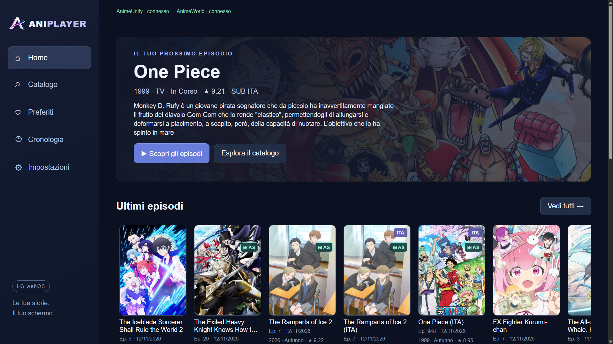
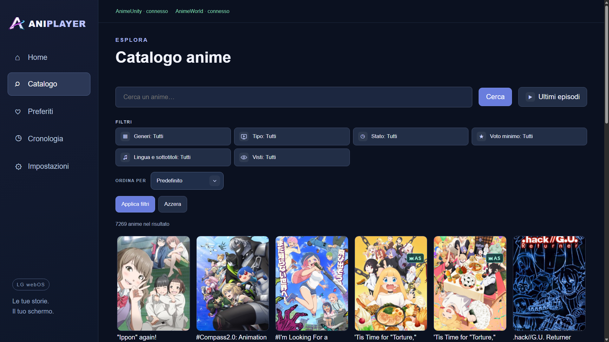
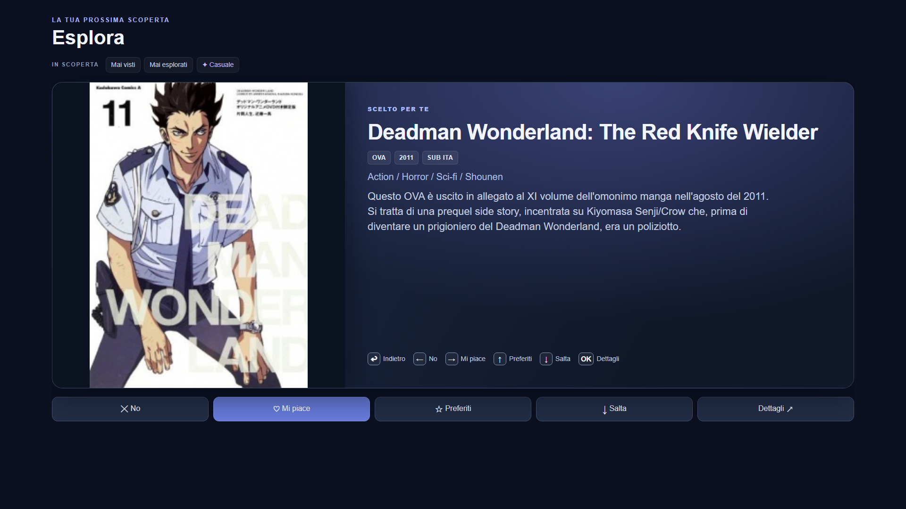
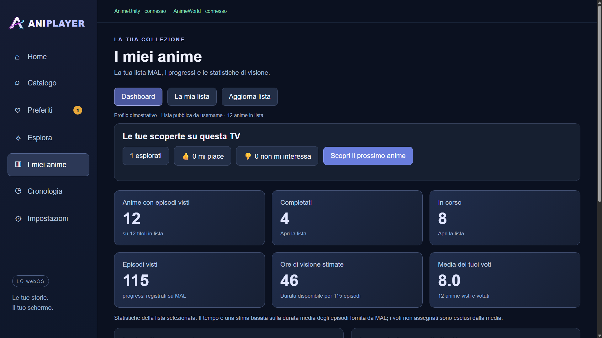

# AniPlayer


AniPlayer è un’app per Smart TV per esplorare anime, guardare episodi e tenere traccia dei progressi. È pensata per il telecomando e si adatta anche a computer e telefoni.

Il catalogo usa AnimeUnity, mentre gli episodi vengono cercati su AnimeWorld. Il collegamento a MyAnimeList è facoltativo.



*Home su TV simulata a 1920×1080.*

Dal menu apri **Catalogo**; per **Esplora** attiva prima la funzione in **Impostazioni → Catalogo**. **I miei anime** compare dopo l’importazione di una lista pubblica o il collegamento MyAnimeList.

| Catalogo | Esplora | I miei anime |
| --- | --- | --- |
|  |  |  |

[Guarda tutte le schermate](docs/SCHERMATE.md), comprese impostazioni, preferiti e cronologia. I dati personali mostrati sono dimostrativi.

## Installa sulla tua Smart TV

Scegli il sistema operativo della TV nelle impostazioni del dispositivo. PC e TV devono essere sulla stessa rete per l’installazione tramite rete. I pacchetti, se disponibili, si trovano nelle **Releases** del repository; altrimenti vanno compilati dai sorgenti.

### Samsung · Tizen

La versione di riferimento richiede **Tizen 9.0 o superiore**. Servono un PC Windows, il Samsung TV SDK e un certificato autorizzato per la propria TV.

1. Attiva **Developer Mode** sulla TV e crea un profilo di firma Samsung. [Preparazione di TV e certificati](docs/GUIDA.md#preparare-tv-e-certificati).
2. Compila il pacchetto WGT con il tuo profilo e installalo sulla TV. Per la prima installazione segui la [guida Samsung passo per passo](docs/GUIDA.md#samsung-tizen).
3. Per gli aggiornamenti usa lo stesso certificato e conserva i dati con il backup. [Aggiornamento e ripristino](docs/GUIDA.md#aggiornamento-con-conservazione-dei-dati).

Per la TV già configurata in questo progetto, `npm run dist` installa il pacchetto disponibile, eseguendo prima il backup. Per ricompilarlo prima dell’invio usa `npm run dist -- -Build`. Lo script usa come valori predefiniti l’IP `192.168.1.103` e il profilo `SamsungS90F`; per altre TV consulta la guida.

### LG · webOS

Installa l’app **Developer Mode** sulla TV, attivala e configura la CLI LG sul PC. Poi installa il pacchetto `.ipk` e avvia AniPlayer. [Guida LG passo per passo](docs/GUIDA.md#lg-webos).

Se dopo l’installazione l’icona non apre l’app, riavvia la TV e riprova.

### Android TV e Google TV

Su Android 8 o superiore, trasferisci `AniPlayer-AndroidTV-debug.apk` sulla TV, aprilo con un gestore file e autorizza l’installazione se richiesta. È possibile installarlo anche con ADB. [Guida Android TV](docs/GUIDA.md#android-tv-e-google-tv).

### Amazon Fire TV · Fire OS

Per Fire OS basato su Android API 26 o superiore, usa lo stesso APK Android e installalo tramite ADB, se il dispositivo consente il sideload. [Guida Fire TV](docs/GUIDA.md#amazon-fire-tv-con-fire-os).

**Compatibilità:** Samsung S90F è il dispositivo di riferimento. Le versioni LG, Android TV e Fire OS sono sperimentali e vanno provate sul proprio dispositivo. Non sono disponibili pacchetti nativi verificati per Vega OS, VIDAA o Roku; Apple TV è esclusa. [Stato delle piattaforme](docs/MULTIPLATFORM.md).

## Prova su PC o telefono

Installa una versione di Node.js compatibile con `package.json`, apri un terminale nella cartella del progetto ed esegui:

```bash
npm ci
npm start
```

Sul PC apri **http://localhost:4200**. Per provare dal telefono collegato alla stessa rete, apri `http://IP_DEL_PC:4200` e lascia acceso il server sul PC. Il server di sviluppo include un proxy per le richieste ai servizi; alcuni video potrebbero comunque essere limitati dal browser.

Su Android puoi anche installare l’APK sperimentale usato per Android TV. [Istruzioni per telefono e PiP](docs/GUIDA.md#prova-su-telefono) · [Avvio e verifiche su PC](docs/GUIDA.md#avvio-sul-pc).

## Come si usa

- **Telecomando:** usa le frecce per spostarti, **OK** per scegliere e **Return** per tornare indietro. Premi OK su un campo per scrivere.
- **Home:** «Scopri gli anime» propone una selezione casuale. Usa **Mescola** per cambiarla o **Vedi tutti** per aprire la stessa sequenza nel catalogo.
- **Catalogo:** cerca per titolo o scegli filtri, generi e voto minimo, poi premi **Applica filtri**. Puoi ordinare per titolo, uscita dell’anime, popolarità o valutazione, anche in modo casuale. **Ultimi episodi** mostra invece gli anime presenti negli aggiornamenti di AnimeUnity, dal più recente. Nelle impostazioni puoi abilitare l’esclusione dei generi: premi OK su un genere per passare tra incluso, escluso e neutro.
- **Esplora:** la funzione è sperimentale e disattivata per impostazione predefinita; puoi abilitarla nelle impostazioni. Mostra un anime alla volta: sulla scheda usa sinistra/destra per esprimere una preferenza, su per i preferiti, giù per saltare e OK per i dettagli. Return torna alla schermata precedente. Su telefono puoi fare swipe sulla copertina.
- **Player:** riprendi gli episodi e, quando disponibili, salta riassunto, sigla iniziale o finale. Dopo un salto hai cinque secondi per annullarlo. I pulsanti `SUB`/`ITA` cambiano versione audio quando disponibili.
- **Impostazioni:** scegli una categoria per gestire menu, catalogo, riproduzione, MyAnimeList e dati salvati.

[Guida completa all’uso e al telecomando](docs/GUIDA.md#telecomando-e-navigazione) · [Come funzionano i salti](docs/GUIDA.md#salta-riassunti-e-sigle).

## MyAnimeList

Le due funzioni sono indipendenti:

1. **Visti da username:** in **Impostazioni → MyAnimeList → Allinea i visti · Senza login** inserisci uno username con lista pubblica. AniPlayer importa i progressi e mostra **I miei anime**, senza modificare la lista MAL.
2. **Aggiornamento automatico:** in **Impostazioni → MyAnimeList → Collega account MAL** collega l’account e autorizza AniPlayer. Potrai inviare i progressi a MAL, mettere in pausa gli aggiornamenti o disconnetterti.

Per il collegamento tramite telefono e PC, avvia `npm run mal:relay` sul PC e segui le istruzioni mostrate sulla TV. [Procedura completa e problemi comuni](docs/GUIDA.md#myanimelist).

## Per chi sviluppa

| Comando | Cosa fa |
| --- | --- |
| `npm run test:all` | Controlla TypeScript, esegue i test e compila il sito. |
| `npm run build:all` | Genera i pacchetti Samsung, LG, Android/Fire OS e browser; richiede gli SDK e la firma Samsung. |
| `npm run dist` | Installa sulla Samsung configurata, con backup e ripristino dei dati. |
| `npm run mal:relay` | Avvia temporaneamente il collegamento MAL tramite telefono. |

Guide: [installazione, backup e risoluzione problemi](docs/GUIDA.md) · [piattaforme](docs/MULTIPLATFORM.md) · [login MAL](docs/MAL_LOGIN.md) · [riconoscimento audio](docs/INTRO_AUDIO.md) · [aggiornare gli screenshot](docs/screenshots/README.md).

## Crediti e utilizzo

AniPlayer usa [AnimeUnity](https://www.animeunity.co/) per il catalogo, [AnimeWorld](https://www.animeworld.ac/) per gli episodi, [AniSkip](https://aniskip.com/) per gli intervalli di salto, [MyAnimeList](https://myanimelist.net/) per liste e progressi e [AniList](https://anilist.co/) per date e copertine. Grazie anche ad [ani-cli-it](https://github.com/nicolagalassi/ani-cli-it), [Angular](https://angular.dev/) e [QRCode.js](https://github.com/davidshimjs/qrcodejs). [Crediti e licenze delle componenti](THIRD_PARTY.md).

AniPlayer è un progetto indipendente: non ospita video e non è affiliato ai servizi elencati. Usa l’app solo per contenuti e servizi ai quali hai diritto di accedere. Nomi, immagini e opere appartengono ai rispettivi titolari. [Disclaimer completo](docs/GUIDA.md#disclaimer-copyright-e-uso-consentito).

Il progetto non ha ancora una licenza generale; consulta [THIRD_PARTY.md](THIRD_PARTY.md) per le componenti incluse e derivate.

