# Schermate di AniPlayer

[Torna al README](../README.md)

Acquisizioni dell’interfaccia TV a **1920×1080**, in simulazione webOS. Preferiti, cronologia, lista e statistiche usano dati dimostrativi: non mostrano un account personale. Catalogo e disponibilità dei titoli possono cambiare.

### Catalogo e ricerca

Dal menu seleziona **Catalogo**.

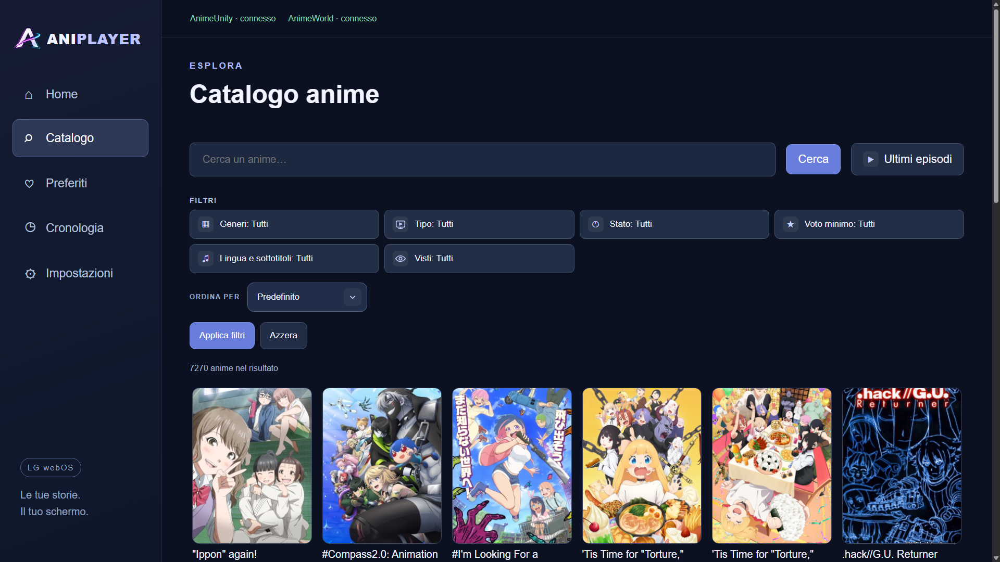

### Scelta dei filtri

Apri **Catalogo** e scegli un filtro, per esempio **Lingua e sottotitoli**.

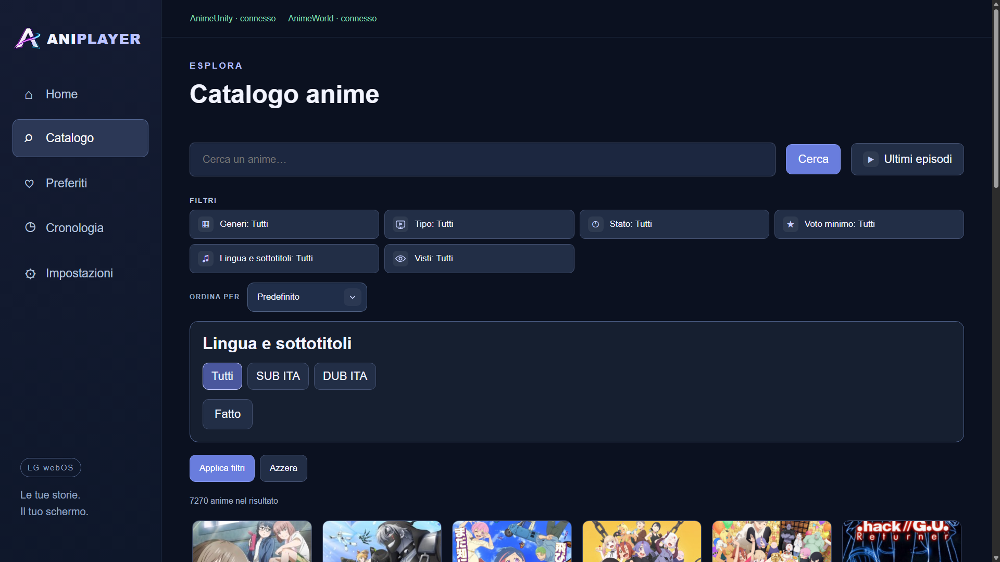

### Esplora

Attiva **Impostazioni → Catalogo → Esplora anime**, poi apri **Esplora** dal menu o dal catalogo.

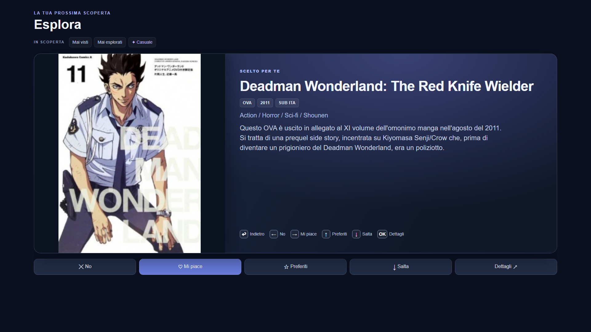

### Dettaglio anime ed episodi

Seleziona una copertina dalla Home, dal catalogo o dalla tua lista.

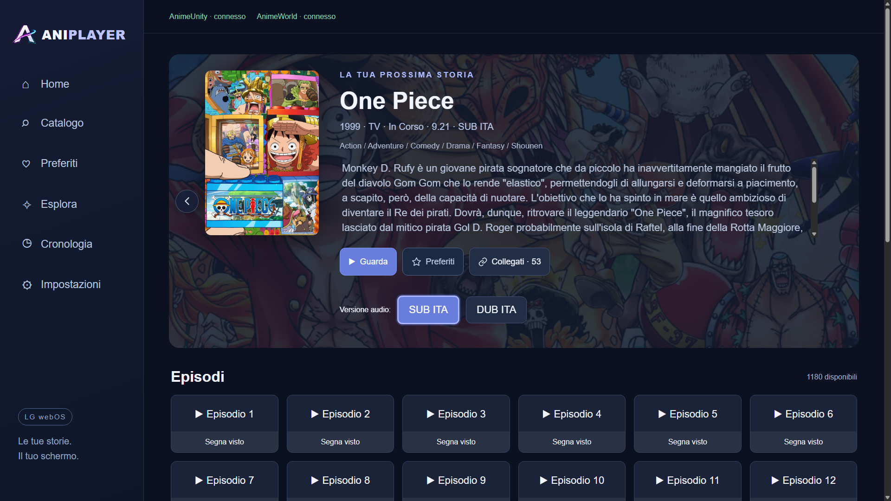

### Preferiti

Dal menu seleziona **Preferiti**.

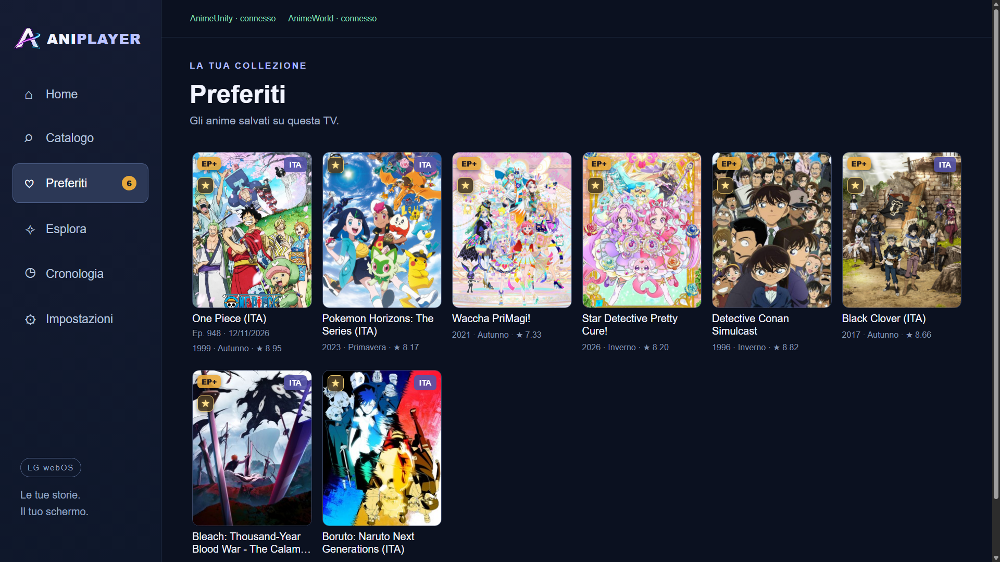

### Continua a guardare

Dal menu seleziona **Cronologia**, oppure apri **Vedi tutti** nella sezione Continua a guardare della Home.

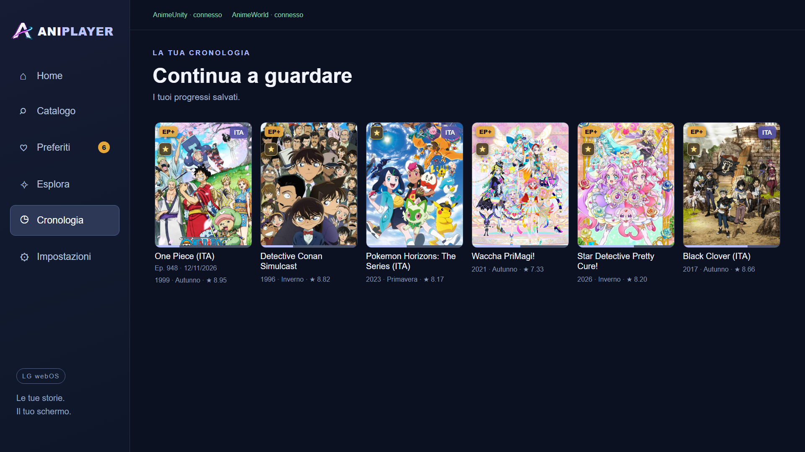

### Dashboard personale

Dopo aver importato una lista pubblica o collegato MAL, seleziona **I miei anime → Dashboard**.

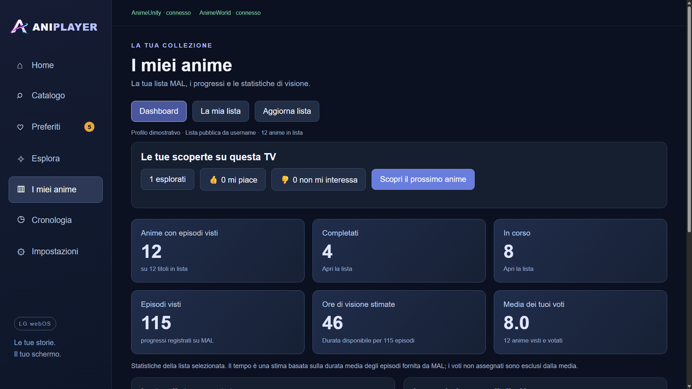

### La mia lista

Apri **I miei anime → La mia lista**.

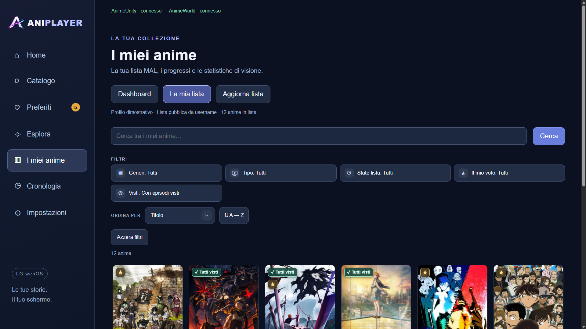

### Impostazioni

Dal menu seleziona **Impostazioni**, poi scegli una categoria.

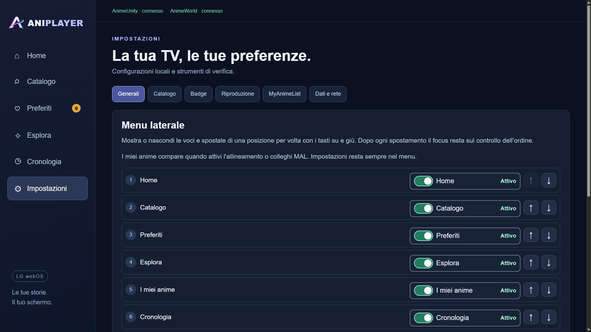

### Badge e indicatori

Apri **Impostazioni → Badge** per scegliere quali indicatori mostrare sulle schede e nel menu. AniSkip è disattivato inizialmente.

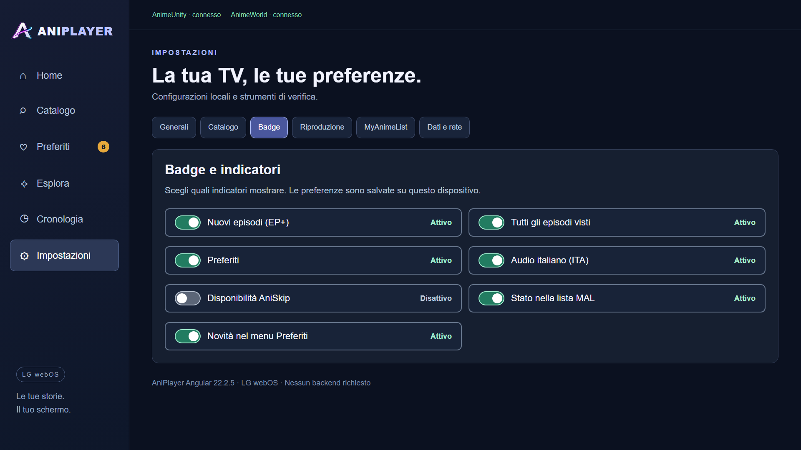

### Collegamento MyAnimeList

Dal menu apri **Impostazioni → MyAnimeList → Collega account MAL**. Per importare una lista pubblica senza collegare l’account scegli **Allinea i visti · Senza login** nella stessa categoria.

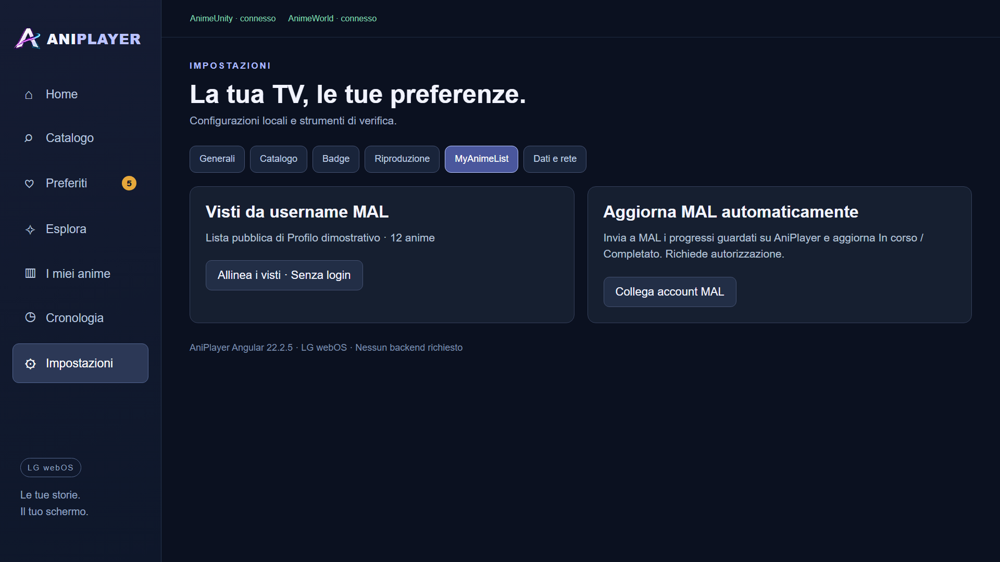

Dopo aver selezionato **Collega account MAL** si apre questa schermata:

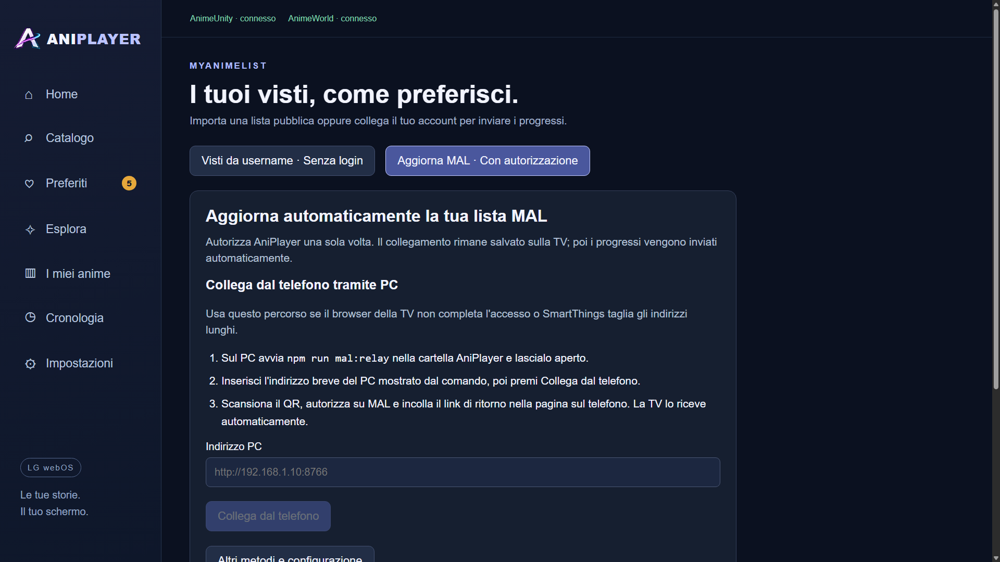

### Servizi e connessioni

Apri **Impostazioni → Dati e rete → Gestisci servizi** per verificare gli indirizzi e le connessioni.

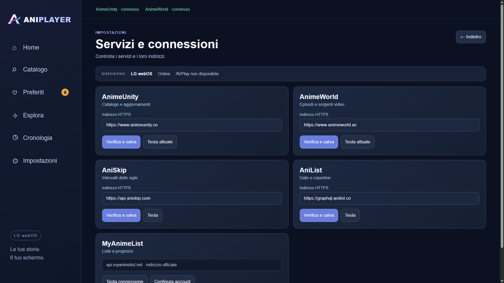

Le immagini vengono sostituite quando aggiorniamo l’interfaccia. Per rigenerarle consulta le [istruzioni degli screenshot](screenshots/README.md).

